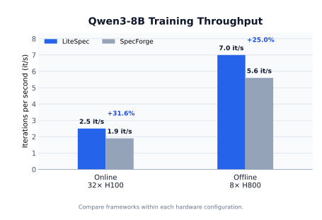

<p align="center">
  
</p>

# LiteSpec

LiteSpec is a unified training framework for four independent speculative
decoding algorithms: **DFlash, DFlash2, DSpark, and DLite**. They share training,
data, distributed execution, metrics, and checkpoint infrastructure while
retaining their own model configurations, architectures, and inference logic.
The installation and Python package name is `litespec`. See
[the training guide](docs/TRAINING.md) for online, offline, and disaggregated examples.

DLite supports SFT, teacher training, two-stage student training, and standalone
evaluation. The student predicts a block in
parallel and uses a lightweight `rnn` sequential head to restore token-to-token
dependence inside the block.

The repository contains the complete training stack. The
[DLite](https://github.com/SJTU-DAI-Sys/DLite) repository is the smaller
inference-only release.

```bash
uv sync --frozen --extra cu128  # Use --extra cu130 for CUDA 13.0
source .venv/bin/activate
```


## Environment

The supported environment is Linux with:

- CPython 3.11 (the repository pins it in `.python-version`);
- an NVIDIA GPU with BF16 support and a driver compatible with the selected CUDA runtime (12.8 or 13.0);
- a CUDA 12.x or 13.x toolkit matching the selected PyTorch CUDA major version when extensions must be built from source;
- [uv](https://docs.astral.sh/uv/) 0.11 or newer.

PyTorch 2.9.1 supports both CUDA 12.8 (`cu128`) and CUDA 13.0 (`cu130`).
Both builds and their runtime libraries are recorded in the lock file.
The system CUDA toolkit is only used to compile extensions, but its major
version must match the PyTorch CUDA build. Check the environment before
installing:

```bash
python3 --version
nvidia-smi
nvcc --version
uv --version
```

Create the complete development and training environment from the checked-in
lock file:

```bash
# CUDA 12.8:
uv sync --frozen --extra cu128
# Or, for CUDA 13.0:
# uv sync --frozen --extra cu130
source .venv/bin/activate
```

Select exactly one CUDA extra.

`uv` builds `causal-conv1d` against the lockfile's exact PyTorch ABI, which is
required by Qwen3.5's hybrid linear-attention layers. Activate `.venv` before
running project commands. General dependencies use public PyPI; PyTorch
CUDA builds use its official indexes. The `cu130` extra also selects the
matching SGLang kernel from its official GitHub release, because its CUDA 13
index contains stale checksums. Release checksums are recorded in `uv.lock`.
A PyPI mirror can be selected locally with `UV_DEFAULT_INDEX` without
changing project files.

FlashAttention is optional. Install the regular dependencies first so PyTorch
is available while FlashAttention is built:

```bash
uv pip install flash-attn --no-build-isolation
```

The supported target backends are `hf` and `sglang`. Attention backend options
provided by PyTorch/Transformers are preserved; FlashAttention falls back to
SDPA when it is unavailable.

## Train

All training entrypoints use their matching YAML by default:

```bash
bash scripts/dflash/run_training_dflash.sh
bash scripts/dflash2/run_training_dflash2.sh
bash scripts/dspark/run_training_dspark.sh
bash scripts/dlite/run_training_dlite_sft.sh
bash scripts/dlite/run_training_dlite_teacher.sh
bash scripts/dlite/run_training_dlite_two_stage.sh
```

Edit the corresponding file under `scripts/config/`, or provide another YAML.
Training CLI arguments after the optional YAML override its `arguments` values:

```bash
bash scripts/dlite/run_training_dlite_teacher.sh \
  scripts/config/dlite_teacher.yaml \
  --batch-size 2 --tp-size 2 --shard-draft-by-tp
```

Both stages consume the same `TRAIN_DATA_PATH`. The student backbone always
starts from random initialization. Stage 1 trains only with weighted KL
distillation; Stage 2 uses the configured CE/TV objectives. The teacher's
sequential head is copied to the student and frozen during Stage 1.

All six launchers also support offline `regen_full` training. In YAML, replace
`launcher.train_data` with `launcher.train_hidden_states`, and set `tp_size: 1`
plus `shard_draft_by_tp: false`. The two data keys are mutually exclusive.
Offline mode skips target-transformer prefill and computes
target logits from cached final-norm hidden states with the frozen LM head.
Newly generated caches include a lightweight per-sample supervision index, so
startup filtering does not deserialize token or hidden-state tensors. Offline
loading is shard-aware and uses persistent workers, pinned batches, and
non-blocking device copies. Regenerate older caches that lack this index.

Online training can instead disaggregate target prefill from draft training.
Configure the shared `disaggregate` block in YAML. For an 8-GPU TP2/EP2
topology, use six target ranks, two draft ranks, and `sglang_ep_size: 2`.
It is online-only and cannot be combined with `shard_draft_by_tp: true`.

```bash
bash scripts/dlite/run_training_dlite_teacher.sh --disaggregate
```

See [docs/TRAINING.md](docs/TRAINING.md) for configuration details.

## Training Results

With a Qwen3-8B target model, LiteSpec achieves higher iteration throughput than SpecForge baseline in both online and offline training. With on-policy sampling and the integration of Muon optimizer, LiteSpec also achieves better training accuracy than baseline:

<p align="center">
  
  
</p>

## Benchmark

```bash
TARGET_MODEL=/path/to/Qwen3-8B \
DRAFT_NAME_OR_PATH=/path/to/student/final \
DATASET=gsm8k MAX_SAMPLES=100 \
bash evaluation/run_benchmark_dlite.sh
```

Checkpoint model settings live under `dlite_config`. The public architecture is
`DLiteDraftModel`; `dlite_v1` uses local anchor position 0 and `dlite_v2` uses
local anchor position 1 while CHS remains at position 0.

## Roadmap

- [x] Support the Muon optimizer
- [ ] Support more target models (Qwen3.8, Gemma, ...)
- [ ] Support more draft architectures and let them be mixed freely
  - Attention: MLA, DSA, KDA, ...
  - Modules: convolution, selector, sequential head, ...

## Acknowledgements

We thank [**SpecForge**](https://github.com/sgl-project/SpecForge) for providing an excellent framework for rapidly validating new ideas and for its foundational training implementation. We also thank [**Hugging Face Transformers**](https://github.com/huggingface/transformers) for the open-source model ecosystem that supports LiteSpec's model workflows.

## License

See [LICENSE](LICENSE).
