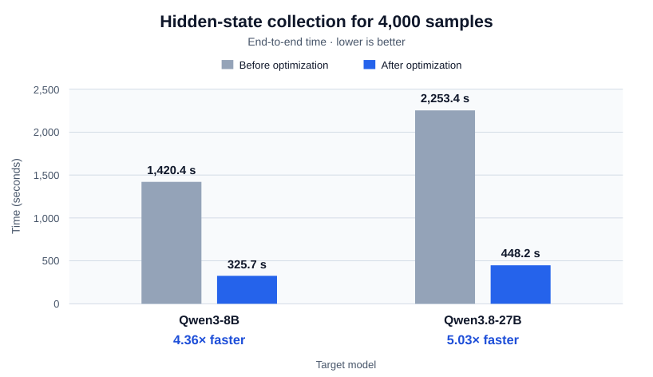
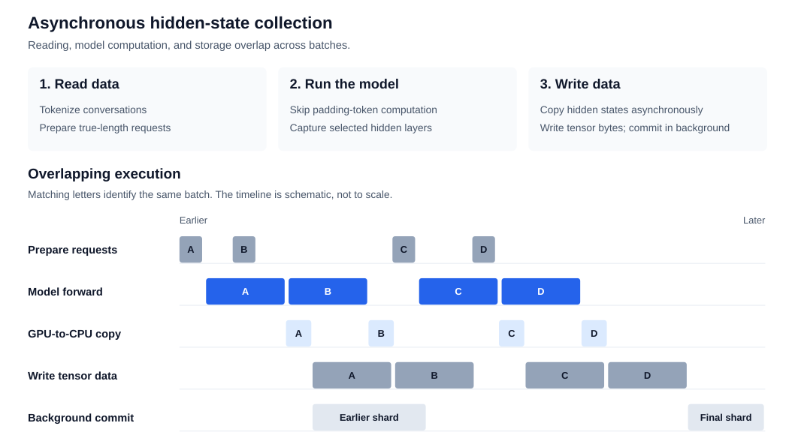

# LiteSpec Optimization 10/14 (Test on H800 GPUs)

1. Reuse RNN/head logits during the DLite transition stage
  - KL and supervised loss share a single student head computation, reducing the number of projections from 2 to 1.
  - Gradient equivalence has been verified.
2. Reuse draft logits for DFlash/DFlash2 logging
  - Metrics use the objective's logits directly, eliminating the extra vocabulary projection on logging steps.
  - Forward passes with metrics require 1 projection per chunk instead of 2.
3. Skip logging callbacks during checkpoint recomputation
  - The backward pass no longer repeats projections and metrics used for logging, including teacher projections needed only for logging.
  - Recomputation required by the training objective is preserved.
4. Reuse distribution diagnostics in DSpark
  - Acceptance probabilities, L1 distances, and teacher/student top-1 probabilities reuse existing results, reducing duplicate softmax operations and reductions.
5. Copy FP32 master parameters directly into BF16 parameters
  - Parameter updates and checkpoint restoration use `copy_(master)`, eliminating the intermediate full-size BF16 tensor previously created before copying.
  - This reduces temporary allocations and memory transfers.
6. Compile and fuse operations after the L1 softmax
  - Preserve native softmax while fusing subtraction, absolute value, weighting, and reduction; CE now remains native.
  - Latest observations from stable training:
    - Loss phase: 24.68 → 22.86 ms, a 7.4% reduction in time.
    - Backward pass: 71.71 → 70.09 ms, a 2.25% reduction in time.
    - Peak allocated memory: 28.70 → 26.67 GiB, a reduction of 2.03 GiB.
7. Compile KL and optimize the teacher computation boundary
  - Compute and detach teacher probabilities in advance, preventing AOTAutograd from recomputing teacher normalization during the backward pass.
  - Historical operator microbenchmarks with exclusive GPU access, shape `[512, 151936]`:
    - FP32: 2.661 → 1.643 ms, a 38.3% reduction in time.
    - BF16: 3.297 → 1.705 ms, a 48.3% reduction in time.
8. Compile BCE with a fallback for small inputs
  - Eligible BCE operations with FP32 targets can be compiled; CPU and small inputs retain native execution in `auto` mode.
  - Shared loss functions use an input-size threshold to avoid unnecessary compilation for small workloads.

# LiteSpec Optimization 10/24 (Test on H800 GPUs)

## Hidden-state data collection

The collection pipeline has three parts: reading conversations, running the
target model, and writing hidden states. The optimized path overlaps their work
instead of waiting for each batch to finish every stage.

### 1. Read data

**Purpose:** turn conversations into token sequences and identify the answer  
tokens used for training.

- Build requests directly from token lists on the CPU, using each sequence's  
actual length. This avoids sending tokens to the GPU only to copy them back  
for request construction.

### 2. Run the model

**Purpose:** compute the selected intermediate hidden states and the final
normalized hidden states used by offline training.

- Pack sequences at their actual lengths, avoiding forward computation on
padding tokens.
- Skip the vocabulary projection when collecting hidden states alone.
- Let all tensor-parallel ranks perform the forward pass together, while one
designated rank handles storage.
- Use a separate transfer stream so copying one batch's hidden states to the  
CPU can overlap with the next forward pass.

### 3. Write data

**Purpose:** store hidden states and sample metadata for later offline training.

- Reuse page-locked host buffers for asynchronous GPU-to-CPU copies.
- Move sample preparation and writing to background workers. Bounded queues
prevent pending work from consuming unlimited memory.
- Write tensor bytes directly inside tar files, avoiding per-sample hidden-state
copies and general-purpose tensor serialization.
- Buffer writes and create the final shards directly, avoiding a second pass
that repackages the entire dataset.
- Commit finished shards in the background while later batches continue.

**Effect:** less copying and serialization, fewer full-dataset passes, and more
overlap between storage and model execution.

### Measured improvement

For 4,000 samples, Qwen3-8B collection time decreased from **1,420.4 seconds to
325.7 seconds**: **4.36× faster**, or **77.1% less time**. Qwen3.8-27B decreased
from **2,253.4 seconds to 448.2 seconds**: **5.03× faster**, or **80.1% less time**. 

### Asynchronous pipeline

The same batch appears on successive execution lanes. Overlapping blocks show
how a later forward pass can run while earlier hidden states are copied or
written. Finished shards are committed independently in the background.

